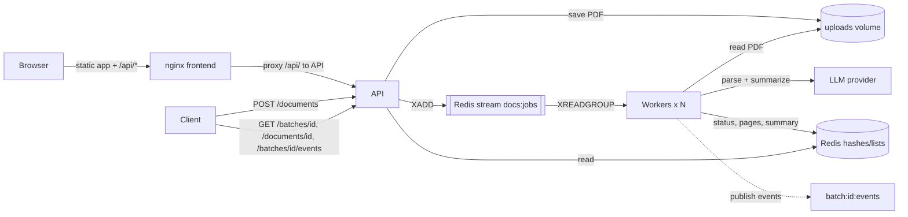
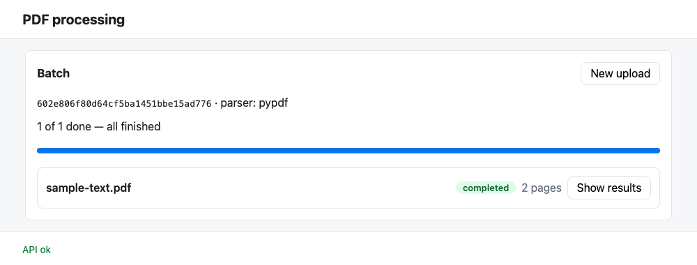

# Async PDF processing service

Upload one or more PDFs, choose a parser (`pypdf` or `llm`; `gemini` is a legacy alias of `llm`), and get per-page text/markdown plus an LLM summary of each file (Gemini or OpenAI, switchable via env). The API (FastAPI) stores uploads on a shared volume and enqueues jobs on a Redis Stream; workers process them and write results to Redis, which clients fetch by polling or SSE. Stack: Python 3.12, FastAPI, Redis 7 Streams, pypdf, google-genai / openai.

## Architecture



Status changes are published to the `batch:{id}:events` Pub/Sub channel; `GET /batches/{id}/events` relays them to clients as Server-Sent Events (one Pub/Sub connection per stream, snapshot first, `done` when every document is finished).

## Run

```bash
cp .env.example .env   # set the API key of your LLM provider
docker compose up --build
curl localhost:8000/health
scripts/demo.sh        # end-to-end demo (needs curl + jq)
```

Services: `frontend` (port 3000), `api` (port 8000), `worker`, `redis`. Host ports are set by `FRONTEND_PORT` / `API_PORT` in `.env` (defaults 3000 / 8000).

Parsers: `pypdf` (local) and `llm`, which calls the provider chosen by `LLM_PROVIDER` (`gemini` or `openai`, default model `gemini-3.1-flash-lite` / `gpt-5-mini`). `parser=gemini` is accepted as a legacy alias of `llm`.

### Troubleshooting

- `Bind for 0.0.0.0:8000 failed: port is already allocated`: another container or process already uses that host port (often a stale compose project: check `docker ps` / `lsof -nP -iTCP:8000 -sTCP:LISTEN`, then `docker compose down` there). Either stop it or set a free port, e.g. `API_PORT=8001` / `FRONTEND_PORT=3001` in `.env`, and use that port in the URLs below.

### Demo

`scripts/demo.sh [base_url]` uploads `samples/sample-text.pdf` with `pypdf` and `samples/sample-layout.pdf` with `llm`, polls `GET /batches/{id}` until every document is `completed`/`failed` (timeout `DEMO_TIMEOUT_SECONDS`, default 180) and prints status, errors and summaries. With `DEMO_WATCH_SSE=1` it first streams each batch's `/events` (printing the event names) before printing results. Without the selected provider's API key the documents still complete, with `summary_status=failed`, while the `llm` parser fails the document with a clear error.

### Scaling workers

Workers are stateless consumers in group `workers`; run more with `docker compose up --build --scale worker=3`. Throughput is `workers x WORKER_CONCURRENCY` jobs; LLM load is capped per process by `LLM_MAX_CONCURRENCY`, so total LLM concurrency grows with the number of workers. The API can be scaled likewise behind a load balancer as long as all replicas share Redis and the uploads volume.

## API

| Endpoint | Description | Details |
|----------|-------------|---------|
| `GET /health` | API + Redis health (`200` / `503`) | [doc](docs/api/health.md) |
| `POST /documents` | Upload PDFs, returns `202` with `batch_id` and document ids | [doc](docs/api/post-documents.md) |
| `GET /parsers` | Selectable parsers and upload limits | [doc](docs/api/get-parsers.md) |
| `GET /documents/{id}` | Status, error, summary, pages (`404` if unknown/expired) | [doc](docs/api/get-document.md) |
| `GET /batches/{id}` | Batch with its documents, without pages (`404`) | [doc](docs/api/get-batch.md) |
| `GET /batches/{id}/events` | SSE stream: `snapshot`, `document`, `done`, `: ping` (`404`) | [doc](docs/api/get-batch-events.md) |

```bash
curl -F files=@a.pdf -F files=@b.pdf -F parser=pypdf localhost:8000/documents
# {"batch_id": "...", "documents": [{"id": "...", "filename": "a.pdf", "status": "queued"}, ...]}
curl localhost:8000/documents/<document_id>
curl localhost:8000/batches/<batch_id>
curl localhost:8000/health
```

Upload errors: `400` (non-PDF, empty, too many files; body `{"detail": [{"filename", "error"}]}`), `413` (file larger than `MAX_FILE_SIZE_MB`), `422` (invalid `parser` / no files), `503` (Redis failure while enqueueing). Any invalid file rejects the whole request and removes saved files.

## Frontend

React + TypeScript (Vite) app in `frontend/`, served by nginx at http://localhost:3000 with `docker compose up --build`. nginx serves the SPA (history fallback) and proxies `/api/` to the `api` service (buffering off and a 1h read timeout for SSE; `client_max_body_size 210m` = `MAX_FILES_PER_UPLOAD` x `MAX_FILE_SIZE_MB` of the defaults, raise it if you raise the limits). The page shows the API status (`GET /health`) and an upload panel: drag & drop or "Choose files" (PDF only, keyboard accessible), a selected-files list (exact duplicates by name + size + lastModified are ignored), and a parser select filled from `GET /parsers` (the API's `default` parser is preselected). Files are validated client-side against the `/parsers` limits (not a PDF, empty, larger than `max_file_size_mb`, more than `max_files_per_upload`); Upload stays disabled while errors exist. Backend errors (400/413/422) are shown, per file when the message names one. On success the selection is cleared, the batch id is put in the URL (`?batch=<id>`) and shown with live progress; "New upload" returns to the form. Opening `/?batch=<id>` (refresh or shared link) shows the same view.

Batch view: header with batch id, parser, "x of n done", a progress bar and a connection indicator (live = SSE, polling = fallback). State comes from `GET /batches/{id}/events` (`snapshot`/`document`/`done`, stale updates ignored via `updated_at`); on an EventSource error it falls back to polling `GET /batches/{id}` every 2s until all documents are completed/failed. Each document card shows filename, a colored status badge, page count, attempts (if > 1) and the error. Completed cards expand (fetching `GET /documents/{id}` once, cached) to show the summary (markdown, or a notice if the summary failed/was skipped), per-page content with prev/next and page-number navigation (`pypdf` pages as preformatted text, other parsers as markdown with tables) and copy buttons for the page and the summary. An unknown or expired batch shows "Batch not found or expired".



Local development (API on :8000, e.g. via compose); Vite proxies `/api` to `http://localhost:8000`:

```bash
cd frontend
npm ci
npm run dev        # http://localhost:5173
npm run lint && npm run typecheck && npm test && npm run build
```

## Parsers

| Parser | How it works | Use when |
|--------|--------------|----------|
| `pypdf` (default) | Extracts the text layer per page, locally and fast | Digital PDFs with selectable text |
| `llm` (alias `gemini`) | Splits the PDF into single pages and asks the configured LLM (`LLM_PROVIDER`, Gemini by default; `gemini` is still accepted and behaves identically; the value is stored as submitted) to convert each to markdown (tables, lists, image/chart descriptions); pages run concurrently with retries, order preserved | Scanned PDFs, or layouts/tables/charts that need markdown. Needs the provider's API key; slower and uses API quota |

Encrypted, corrupted and zero-page PDFs fail with a user-facing error (both parsers); a missing API key for the configured provider fails `llm`/`gemini` documents with a clear error. A page that keeps failing after retries is a transient failure of the whole document (worker retry policy applies). `pypdf` on a PDF without a text layer completes with the note "no text layer found; try the llm parser". See [parsers](docs/features/parsers.md).

## Worker

`python -m app.worker.main` (compose service `worker`; scale with `docker compose up --scale worker=3`). Each worker is a consumer `hostname-pid` in group `workers`, processing up to `WORKER_CONCURRENCY` jobs concurrently.

Pipeline: skip if `completed` -> `parsing` -> parse per page -> store pages + `page_count` -> `summarizing` -> summary step (LLM, see [summarization](docs/features/summarization.md)) -> `completed` -> `XACK`.

- `ParserError` is permanent: document `failed`, job acked.
- Other exceptions are transient: re-enqueued with `attempt+1` while `attempt < MAX_ATTEMPTS`; afterwards the document is `failed` and the job goes to `docs:jobs:dead`.
- `XAUTOCLAIM` takes over jobs idle longer than `CLAIM_IDLE_MS` (crashed consumers).
- SIGTERM/SIGINT: stop reading, finish in-flight jobs.
- Upload cleanup: at startup and every `UPLOAD_CLEANUP_INTERVAL_SECONDS` each worker deletes `*.pdf` files in `UPLOAD_DIR` whose mtime is older than `UPLOAD_TTL_SECONDS` (file I/O in `asyncio.to_thread`; concurrent workers and missing files are tolerated).

See [worker](docs/features/worker.md), [queue](docs/features/queue.md).

## Redis data model

| Key | Type | Content |
|-----|------|---------|
| `docs:jobs` | stream | fields `document_id`, `attempt`; group `workers` |
| `docs:jobs:dead` | stream | exhausted jobs (`document_id`, `attempt`, `error`) |
| `doc:{id}` | hash | id, batch_id, filename, parser, status (`queued\|parsing\|summarizing\|completed\|failed`), summary_status (`pending\|completed\|failed\|skipped`), summary, error, page_count, attempts, created_at, updated_at |
| `doc:{id}:pages` | list | JSON `{"page", "content"}` |
| `batch:{id}` / `batch:{id}:docs` | hash / list | id, parser, created_at / document ids |
| `batch:{id}:events` | pub/sub | JSON `{document_id, status}` on every status change |

All keys expire after `DATA_TTL_SECONDS`; uploaded files live in `UPLOAD_DIR/{document_id}.pdf`, never in Redis, and are deleted by a periodic worker cleanup once older than `UPLOAD_TTL_SECONDS` (default 7 days, same as the Redis TTL). See [repository](docs/features/repository.md), [storage](docs/features/storage.md).

## Configuration

All via environment (see `.env.example`).

| Variable | Default | Meaning |
|----------|---------|---------|
| `REDIS_URL` | `redis://localhost:6379/0` | Redis connection (compose overrides) |
| `UPLOAD_DIR` | `/data/uploads` | Shared upload volume (compose overrides) |
| `DATA_TTL_SECONDS` | `604800` | TTL for all Redis keys |
| `UPLOAD_TTL_SECONDS` | `604800` | Retention of files in `UPLOAD_DIR`; keep equal to `DATA_TTL_SECONDS` (7 days) |
| `UPLOAD_CLEANUP_INTERVAL_SECONDS` | `3600` | How often each worker deletes expired uploads |
| `MAX_FILE_SIZE_MB` | `20` | Max size per file |
| `MAX_FILES_PER_UPLOAD` | `10` | Max files per request |
| `LLM_PROVIDER` | `gemini` | `gemini` or `openai` |
| `LLM_MODEL` | empty | Model name; empty = provider default (`gemini-3.1-flash-lite` / `gpt-5-mini`) |
| `GEMINI_API_KEY` | empty | Gemini API key (needed when `LLM_PROVIDER=gemini`) |
| `OPENAI_API_KEY` | empty | OpenAI API key (needed when `LLM_PROVIDER=openai`) |
| `LLM_MAX_CONCURRENCY` | `2` | Max concurrent LLM requests per process (legacy name `GEMINI_MAX_CONCURRENCY` still accepted) |
| `LLM_TIMEOUT_SECONDS` | `60` | Per-request timeout (legacy `GEMINI_TIMEOUT_SECONDS`) |
| `LLM_MAX_RETRIES` | `4` | Attempts per request on 429/5xx/timeouts (exponential backoff + jitter; legacy `GEMINI_MAX_RETRIES`) |
| `SUMMARY_MAX_INPUT_CHARS` | `100000` | Document text sent to the LLM is truncated to this length |
| `WORKER_CONCURRENCY` | `4` | Concurrent jobs per worker |
| `MAX_ATTEMPTS` | `3` | Attempts before dead-lettering |
| `CLAIM_IDLE_MS` | `60000` | Idle time before a pending job is reclaimed |
| `SSE_HEARTBEAT_SECONDS` | `15` | Interval of `: ping` comments on the SSE stream |
| `SSE_MAX_DURATION_SECONDS` | `600` | Max SSE stream lifetime; clients reconnect |
| `LOG_LEVEL` | `INFO` | Logging level |

## Switching the LLM provider

Only env vars change; no code edits. Restart api and worker after editing `.env`.

```bash
# Gemini (default)
LLM_PROVIDER=gemini
GEMINI_API_KEY=...
# LLM_MODEL=gemini-3.1-flash-lite   # optional

# OpenAI
LLM_PROVIDER=openai
OPENAI_API_KEY=...
LLM_MODEL=gpt-5-mini                # optional
```

`LLM_MODEL` is any model name the provider accepts (empty = provider default). Summaries and the `llm` parser both use the configured provider, sharing one global concurrency limit and retry policy (`app/llm/client.py`). OpenAI receives each page as a base64 PDF `input_file` via the Responses API. The parser values `llm` and the legacy `gemini` are both accepted (same `LlmParser` in `app/parsers/llm_parser.py`), independent of the provider. A missing key (or unknown provider) fails `llm`-parser documents with a clear error and marks summaries `failed`.

### Adding a provider

1. Create `app/llm/<name>.py` with a class that has `name`, `default_model`, `__init__(settings, model)` (raise `LLMConfigError` if the key is missing) and async `generate(prompt)` / `generate_from_pdf(pdf_bytes, prompt)` (the `LLMProvider` protocol in `app/llm/base.py`). Map the SDK's 429/5xx/timeout errors to `RetryableLLMError`; let other errors propagate.
2. Add its key setting to `app/config.py` and `.env.example`.
3. Register the class in `PROVIDERS` in `app/llm/factory.py`.

Retries and the concurrency semaphore are provider-agnostic and need no changes. LangChain was deliberately not used: only two operations are needed, and the adapter avoids a heavy dependency.

## Getting API keys

### Gemini

1. Open [Google AI Studio](https://aistudio.google.com/apikey) and sign in with a Google account.
2. Click **Create API key** (free tier, no billing needed) and copy it.
3. Put it in `.env` as `GEMINI_API_KEY=...` and restart the worker.

OpenAI: create a key at [platform.openai.com/api-keys](https://platform.openai.com/api-keys) and set `OPENAI_API_KEY` with `LLM_PROVIDER=openai`.

The free tier has low per-minute/per-day request limits; `429` responses are retried with backoff, and `LLM_MAX_CONCURRENCY` (default `2`) keeps load down. If limits persist, lower the concurrency or upload fewer files at once. Details: [summarization](docs/features/summarization.md).

## Retry and failure semantics

- Delivery is at-least-once: a job is acked only after the document reaches a final state; processing is idempotent (completed documents are skipped).
- Permanent failures (`ParserError`: encrypted, corrupted, zero pages, missing provider API key for the `llm` parser) mark the document `failed` immediately.
- Transient failures are re-enqueued with `attempt+1` up to `MAX_ATTEMPTS`; then the document is `failed` and the job is copied to `docs:jobs:dead`.
- Crashed workers: pending jobs idle longer than `CLAIM_IDLE_MS` are reclaimed by another worker via `XAUTOCLAIM`.
- Summary failures never fail a document (see Assumptions).
- Errors are plain JSON: upload validation returns `{"detail": [{"filename", "error"}]}`; other errors return `{"detail": "message"}` (`400`, `404`, `413`, `422`, `503`).

## Logging

Standard `logging` with `key=value` context (`document_id`, `batch_id`, `attempt`, `entry_id`); level via `LOG_LEVEL`. All blocking work (pypdf, file I/O) runs in `asyncio.to_thread`.

## Tests

```bash
cd backend
uv sync
uv run ruff check .
uv run pytest
```

`tests/test_concurrency.py` fires 20 concurrent uploads and verifies all are accepted and processed (fakeredis, mocked LLM). Provider tests (`tests/test_llm.py`) use mocked SDK clients; no network.

## Packaging

`scripts/package.sh` builds `submission.zip` (git-ignored) from the committed files (`git archive`), so `.env`, `.venv`, `node_modules` and caches are never included; commit your changes first. It also leaves out `tasks.md`, `system-prompt.md`, `scripts/package.sh` itself, and all dotfiles/dot-directories except `.env.example`.

## Trade-offs

- Redis Streams as queue/store keeps the stack small (one dependency) at the cost of Redis memory limits and TTL-based retention (no durable history).
- Files on a shared volume avoid putting bytes in Redis but tie api and workers to shared storage.
- SSE over Redis Pub/Sub avoids polling but costs one Redis connection per open stream and is not durable: events missed while disconnected are recovered via the snapshot on reconnect (no `Last-Event-ID`). Polling remains available.
- Summaries are sent as one truncated request (`SUMMARY_MAX_INPUT_CHARS`) rather than map-reduce: cheap, but long documents are partially summarized.
- Upload retention is mtime-based and independent of Redis: a document still being retried after 7 days would find its file gone (permanent in practice since jobs also expire with the Redis TTL). Every worker runs the cleanup; deletions are idempotent, so no leader election is needed.
- At-least-once delivery means an LLM request can be repeated after a crash.

## Future work

- Authentication and multi-tenancy (per-user quotas and access control).
- PII masking before sending text to the LLM.
- Virus scanning of uploads.
- Object storage (S3/GCS) instead of the shared volume.
- Metrics and tracing (Prometheus/OpenTelemetry), queue-depth autoscaling.

## Assumptions

- `GET /parsers` does not yet report parser availability; the frontend supports an optional `unavailable_parsers` field and treats all listed parsers as available otherwise.
- No authentication: anyone who can reach the API can upload and read. Document and batch ids are random UUIDs (uuid4 hex) and act as unguessable capability tokens.
- SSE streams are capped at `SSE_MAX_DURATION_SECONDS`; clients are expected to reconnect (the snapshot makes this safe).
- `.env` is required by compose; `REDIS_URL` and `UPLOAD_DIR` are overridden in compose for container paths.
- Upload validation errors use `413` if any file is oversized, otherwise `400`; too many files is `400`.
- A password-protected PDF is only supported if it opens with an empty password.
- A missing upload file is treated as a transient error (retried, then dead-lettered).
- Empty `error`/`summary` are returned as `null`.
- A summary failure (including a missing API key) does not fail the document: pages are kept, `summary_status=failed`, `error` holds the reason, status is `completed`. Documents without text get `summary_status=skipped`.
- Uploaded files are removed after `UPLOAD_TTL_SECONDS` (default equals `DATA_TTL_SECONDS`); keep the two in sync so a document never outlives its file or vice versa.
- A missing document hash (expired TTL) makes the worker drop the job.
