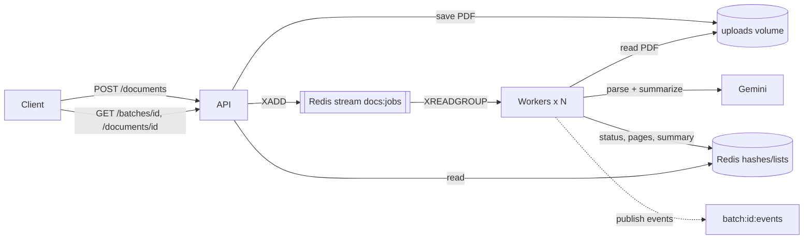

# Async PDF processing service

Upload one or more PDFs, choose a parser (`pypdf` or `gemini`), and get per-page text/markdown plus a Gemini summary of each file. The API (FastAPI) stores uploads on a shared volume and enqueues jobs on a Redis Stream; workers process them and write results to Redis, which clients fetch by polling. Stack: Python 3.12, FastAPI, Redis 7 Streams, pypdf, google-genai.

## Architecture



Status changes are published to the `batch:{id}:events` Pub/Sub channel; an SSE endpoint on top of it is not implemented yet (clients poll).

## Run

```bash
cp .env.example .env   # set GEMINI_API_KEY when needed
docker compose up --build
curl localhost:8000/health
scripts/demo.sh        # end-to-end demo (needs curl + jq)
```

Services: `api` (port 8000), `worker`, `redis`.

### Demo

`scripts/demo.sh [base_url]` uploads `samples/sample-text.pdf` with `pypdf` and `samples/sample-layout.pdf` with `gemini`, polls `GET /batches/{id}` until every document is `completed`/`failed` (timeout `DEMO_TIMEOUT_SECONDS`, default 180) and prints status, errors and summaries. Without `GEMINI_API_KEY` the documents still complete, with `summary_status=failed`, while the `gemini` parser fails the document with a clear error.

### Scaling workers

Workers are stateless consumers in group `workers`; run more with `docker compose up --build --scale worker=3`. Throughput is `workers x WORKER_CONCURRENCY` jobs; Gemini load is capped per process by `GEMINI_MAX_CONCURRENCY`, so total Gemini concurrency grows with the number of workers. The API can be scaled likewise behind a load balancer as long as all replicas share Redis and the uploads volume.

## API

| Endpoint | Description | Details |
|----------|-------------|---------|
| `GET /health` | API + Redis health (`200` / `503`) | [doc](docs/api/health.md) |
| `POST /documents` | Upload PDFs, returns `202` with `batch_id` and document ids | [doc](docs/api/post-documents.md) |
| `GET /documents/{id}` | Status, error, summary, pages (`404` if unknown/expired) | [doc](docs/api/get-document.md) |
| `GET /batches/{id}` | Batch with its documents, without pages (`404`) | [doc](docs/api/get-batch.md) |

```bash
curl -F files=@a.pdf -F files=@b.pdf -F parser=pypdf localhost:8000/documents
# {"batch_id": "...", "documents": [{"id": "...", "filename": "a.pdf", "status": "queued"}, ...]}
curl localhost:8000/documents/<document_id>
curl localhost:8000/batches/<batch_id>
curl localhost:8000/health
```

Upload errors: `400` (non-PDF, empty, too many files; body `{"detail": [{"filename", "error"}]}`), `413` (file larger than `MAX_FILE_SIZE_MB`), `422` (invalid `parser` / no files), `503` (Redis failure while enqueueing). Any invalid file rejects the whole request and removes saved files.

## Parsers

| Parser | How it works | Use when |
|--------|--------------|----------|
| `pypdf` (default) | Extracts the text layer per page, locally and fast | Digital PDFs with selectable text |
| `gemini` | Splits the PDF into single pages and asks Gemini to convert each to markdown (tables, lists, image/chart descriptions); pages run concurrently with retries, order preserved | Scanned PDFs, or layouts/tables/charts that need markdown. Needs `GEMINI_API_KEY`; slower and uses API quota |

Encrypted, corrupted and zero-page PDFs fail with a user-facing error (both parsers); a missing `GEMINI_API_KEY` fails `gemini` documents with a clear error. A page that keeps failing after retries is a transient failure of the whole document (worker retry policy applies). `pypdf` on a PDF without a text layer completes with the note "no text layer found; try the gemini parser". See [parsers](docs/features/parsers.md).

## Worker

`python -m app.worker.main` (compose service `worker`; scale with `docker compose up --scale worker=3`). Each worker is a consumer `hostname-pid` in group `workers`, processing up to `WORKER_CONCURRENCY` jobs concurrently.

Pipeline: skip if `completed` -> `parsing` -> parse per page -> store pages + `page_count` -> `summarizing` -> summary step (Gemini, see [summarization](docs/features/summarization.md)) -> `completed` -> `XACK`.

- `ParserError` is permanent: document `failed`, job acked.
- Other exceptions are transient: re-enqueued with `attempt+1` while `attempt < MAX_ATTEMPTS`; afterwards the document is `failed` and the job goes to `docs:jobs:dead`.
- `XAUTOCLAIM` takes over jobs idle longer than `CLAIM_IDLE_MS` (crashed consumers).
- SIGTERM/SIGINT: stop reading, finish in-flight jobs.

See [worker](docs/features/worker.md), [queue](docs/features/queue.md).

## Redis data model

| Key | Type | Content |
|-----|------|---------|
| `docs:jobs` | stream | fields `document_id`, `attempt`; group `workers` |
| `docs:jobs:dead` | stream | exhausted jobs (`document_id`, `attempt`, `error`) |
| `doc:{id}` | hash | id, batch_id, filename, parser, status (`queued\|parsing\|summarizing\|completed\|failed`), summary_status (`pending\|completed\|failed\|skipped`), summary, error, page_count, attempts, created_at, updated_at |
| `doc:{id}:pages` | list | JSON `{"page", "content"}` |
| `batch:{id}` / `batch:{id}:docs` | hash / list | id, parser, created_at / document ids |
| `batch:{id}:events` | pub/sub | JSON `{document_id, status}` on every status change |

All keys expire after `DATA_TTL_SECONDS`; uploaded files live in `UPLOAD_DIR/{document_id}.pdf`, never in Redis. See [repository](docs/features/repository.md), [storage](docs/features/storage.md).

## Configuration

All via environment (see `.env.example`).

| Variable | Default | Meaning |
|----------|---------|---------|
| `REDIS_URL` | `redis://localhost:6379/0` | Redis connection (compose overrides) |
| `UPLOAD_DIR` | `/data/uploads` | Shared upload volume (compose overrides) |
| `DATA_TTL_SECONDS` | `604800` | TTL for all Redis keys |
| `MAX_FILE_SIZE_MB` | `20` | Max size per file |
| `MAX_FILES_PER_UPLOAD` | `10` | Max files per request |
| `GEMINI_API_KEY` | empty | Gemini API key (required for summaries) |
| `GEMINI_MODEL` | `gemini-3.1-flash-lite` | Gemini model |
| `GEMINI_MAX_CONCURRENCY` | `2` | Max concurrent Gemini requests per process |
| `GEMINI_TIMEOUT_SECONDS` | `60` | Per-request timeout |
| `GEMINI_MAX_RETRIES` | `4` | Attempts per request on 429/5xx/timeouts (exponential backoff + jitter) |
| `SUMMARY_MAX_INPUT_CHARS` | `100000` | Document text sent to Gemini is truncated to this length |
| `WORKER_CONCURRENCY` | `4` | Concurrent jobs per worker |
| `MAX_ATTEMPTS` | `3` | Attempts before dead-lettering |
| `CLAIM_IDLE_MS` | `60000` | Idle time before a pending job is reclaimed |
| `LOG_LEVEL` | `INFO` | Logging level |

## Gemini API key and summaries

1. Open [Google AI Studio](https://aistudio.google.com/apikey) and sign in with a Google account.
2. Click **Create API key** (free tier, no billing needed) and copy it.
3. Put it in `.env` as `GEMINI_API_KEY=...` and restart the worker.

The free tier has low per-minute/per-day request limits; `429` responses are retried with backoff, and `GEMINI_MAX_CONCURRENCY` (default `2`) keeps load down. If limits persist, lower the concurrency or upload fewer files at once. Details: [summarization](docs/features/summarization.md).

## Retry and failure semantics

- Delivery is at-least-once: a job is acked only after the document reaches a final state; processing is idempotent (completed documents are skipped).
- Permanent failures (`ParserError`: encrypted, corrupted, zero pages, missing Gemini key for the `gemini` parser) mark the document `failed` immediately.
- Transient failures are re-enqueued with `attempt+1` up to `MAX_ATTEMPTS`; then the document is `failed` and the job is copied to `docs:jobs:dead`.
- Crashed workers: pending jobs idle longer than `CLAIM_IDLE_MS` are reclaimed by another worker via `XAUTOCLAIM`.
- Summary failures never fail a document (see Assumptions).
- Errors are plain JSON: upload validation returns `{"detail": [{"filename", "error"}]}`; other errors return `{"detail": "message"}` (`400`, `404`, `413`, `422`, `503`).

## Logging

Standard `logging` with `key=value` context (`document_id`, `batch_id`, `attempt`, `entry_id`); level via `LOG_LEVEL`. All blocking work (pypdf, file I/O) runs in `asyncio.to_thread`.

## Tests

```bash
cd backend
uv sync
uv run ruff check .
uv run pytest
```

`tests/test_concurrency.py` fires 20 concurrent uploads and verifies all are accepted and processed (fakeredis, mocked Gemini).

## Packaging

`git archive -o app.zip HEAD` contains only tracked files; `.gitattributes` and `.gitignore`/`.dockerignore` additionally exclude `.venv`, `node_modules` and `.env`.

## Trade-offs

- Redis Streams as queue/store keeps the stack small (one dependency) at the cost of Redis memory limits and TTL-based retention (no durable history).
- Files on a shared volume avoid putting bytes in Redis but tie api and workers to shared storage.
- Polling is simple and stateless; Pub/Sub events are published but no SSE endpoint exists yet.
- Summaries are sent as one truncated request (`SUMMARY_MAX_INPUT_CHARS`) rather than map-reduce: cheap, but long documents are partially summarized.
- At-least-once delivery means a Gemini request can be repeated after a crash.

## Future work

- Authentication and multi-tenancy (per-user quotas and access control).
- PII masking before sending text to Gemini.
- Virus scanning of uploads.
- Object storage (S3/GCS) instead of the shared volume.
- Metrics and tracing (Prometheus/OpenTelemetry), queue-depth autoscaling.
- SSE endpoint `GET /batches/{id}/events`, GPT-5 Mini OCR parser, web frontend.

## Assumptions

- No authentication: anyone who can reach the API can upload and read. Document and batch ids are random UUIDs (uuid4 hex) and act as unguessable capability tokens.
- The GPT-5 Mini parser is not implemented (nice-to-have PR 8 not done); only `pypdf` and `gemini` exist.
- SSE is not implemented; clients poll `GET /batches/{id}` / `GET /documents/{id}`.
- `.env` is required by compose; `REDIS_URL` and `UPLOAD_DIR` are overridden in compose for container paths.
- Upload validation errors use `413` if any file is oversized, otherwise `400`; too many files is `400`.
- A password-protected PDF is only supported if it opens with an empty password.
- A missing upload file is treated as a transient error (retried, then dead-lettered).
- Empty `error`/`summary` are returned as `null`.
- A summary failure (including a missing `GEMINI_API_KEY`) does not fail the document: pages are kept, `summary_status=failed`, `error` holds the reason, status is `completed`. Documents without text get `summary_status=skipped`.
- A missing document hash (expired TTL) makes the worker drop the job.
